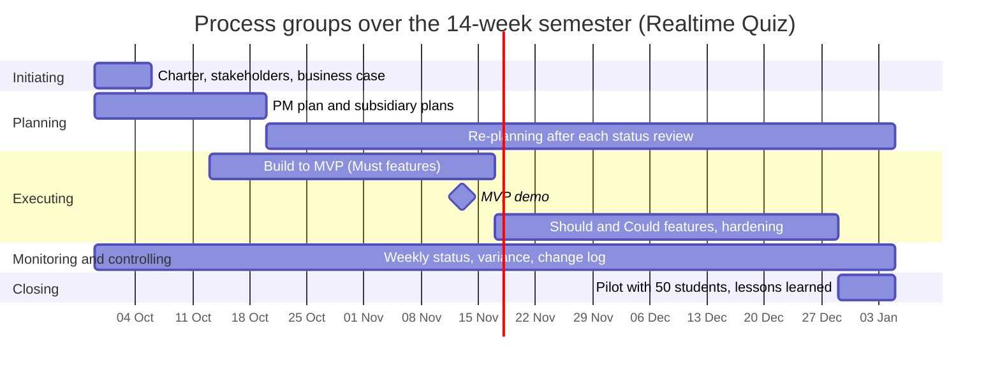

# Process groups mapping: Realtime Quiz platform

## 1. Process groups across the 14-week semester

| Process group | Weeks active | Main activities | Outputs | Lab that produces them |
|---------------|--------------|-----------------|---------|------------------------|
| Initiating | Week 1 | Defining project purpose, securing sponsor mandate, identifying preliminary stakeholders, developing initial business case justification | Project charter, initial stakeholder register, business case | Lab-01 |
| Planning | Weeks 1–3 (initial baseline) & Weeks 4–14 (iterative re-planning) | Decomposing scope into WBS, estimating activity durations, building network schedule, establishing cost and quality baselines, risk planning | Project management plan, WBS dictionary, schedule baseline, cost budget, risk register, subsidiary plans | Labs 02, 03, 04, 05, 06, 07, 08, 09, 10, 11, 12 |
| Executing | Weeks 3–13 | Software implementation, UI/UX component development, WebSocket real-time engine integration, sprint demos, code reviews, automated testing | Working software increments, test execution reports, MVP demo release, release tags | Labs 03, 07, 08 (practical execution) |
| Monitoring and controlling | Weeks 1–14 (continuous) | Weekly progress tracking, schedule and cost variance analysis (EVM), tracking quality metrics, managing change requests, risk reassessment | Weekly status reports, change log, variance audit reports, updated baselines | Labs 05, 06, 07, 09 (tools) and continuous across all labs |
| Closing | Weeks 13–14 | Conducting 50-student classroom pilot, user acceptance verification, operational runbook handover to IT ops, lessons learned session, archiving | Pilot evaluation report, operational runbook, final closure report, lessons learned register | Lab-12 |

## 2. Process groups over the semester

## 3. Phase gates

To safeguard investment and maintain continued business justification throughout the project lifecycle, three formal phase gates are established where the Sponsor explicitly decides to authorize continuation, request corrective change, or terminate the endeavor:

1. **Gate 1: Charter Approval & Project Initiation (Week 1, 2026-10-06)**  
   *Decision:* Formally authorize project commencement and allocate departmental resources.  
   *Evidence Required:* Formally signed Project Charter, initial Stakeholder Register with confirmed roles, and the quantitative Business Case establishing economic viability and payback.
2. **Gate 2: MVP Demonstration & Mid-Semester Review (Week 7, 2026-11-13)**  
   *Decision:* Authorize progression into secondary feature development and pilot preparations, or enact contingency plan.  
   *Evidence Required:* Live demonstration of all Must features (quiz authoring, PIN join, synchronized timer, scoring, and live WebSocket leaderboard) functioning with zero blocking defects, automated CI test line coverage >= 80%, and an EVM schedule/cost performance report confirming no fatal project variance. (Failure triggers immediate pivot to commercial SaaS Option B).
3. **Gate 3: Pilot Readiness & Operational Handover (Week 13, 2026-12-22)**  
   *Decision:* Authorize deployment of Realtime Quiz into the live lecture environment with 50 real students.  
   *Evidence Required:* Successful 100-simulated-student load test report confirming broadcast latency <= 500 ms and zero server crashes, verified SockJS fallback over campus proxies, formal sign-off from the Data Protection Officer (S08) regarding student privacy compliance, and an operations runbook signed by IT Operations (S06).

